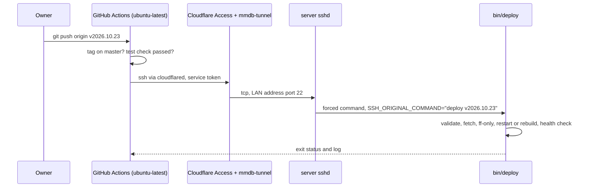

# Design

## Context

- The production app runs on a server on the home LAN, reachable only from that network. Its address and username are kept out of this public repo; the docs write them as `<server-lan-address>` and `<user>`. `~/MMDb` is a git checkout of `toddseller/MMDb` (HTTPS remote, `master` tracking `origin/master`), mounted into the `mmdb-web-1` container by `docker-compose.yml`. The public reaches it through the `mmdb-tunnel` cloudflared container (`~/mmdb-tunnel/docker-compose.yml`, tunnel ID `0f84057b-...`). It was created from the container rather than in the Cloudflare UI, but it runs with only `TUNNEL_TOKEN` and no local config file, so its routes come from Cloudflare: each start logs `Updated to new configuration` with the `mmdb.online` rule. The tunnel is listed in the Zero Trust dashboard, so new routes are added there. That container can reach the host at `<server-lan-address>:22`, where `sshd` runs.
- The repo is public. `master` is protected by a ruleset that requires a PR and the `test` check from `.github/workflows/test.yml`.
- The manual deploy is `git pull --ff-only`, then `docker compose restart web`, or `docker compose up -d --build` when gems or the image changed.

## Goals / Non-Goals

**Goals:**
- A tag push deploys with no SSH session from the LAN, and the result shows on the tag in GitHub.
- Nothing that comes from the public repo, other than the reviewed deploy script on `master`, runs on the server.
- The deploy decisions (refuse, rebuild or restart, health) are tested in CI.

**Non-Goals:**
- Zero-downtime deploys; a restart takes a few seconds, as today.
- Managing `.env`, the database, or myflix.

## Decisions

### Workflow: `.github/workflows/deploy.yml`

- `on: push: tags: ['v*']`, `environment: production`, `concurrency: { group: production, cancel-in-progress: false }`, `permissions: { contents: read, checks: read }`.
- **Check:** `actions/checkout` with `fetch-depth: 0`, then `git merge-base --is-ancestor "$GITHUB_SHA" origin/master`, and `gh api repos/{repo}/commits/$GITHUB_SHA/check-runs?check_name=test` with `GITHUB_TOKEN`, requiring the latest run's `conclusion == success`. The workflow filter is `v*`, so the exact format (`^v[0-9]+(\.[0-9]+)*$`) is checked here too, and again on the server.
- **Connect:** install `cloudflared` from Cloudflare's release package, write the deploy key and the pinned `known_hosts` line from secrets into `~/.ssh` with mode 600, then `ssh -o StrictHostKeyChecking=yes -o ProxyCommand='cloudflared access ssh --hostname %h' "$DEPLOY_SSH_TARGET" "deploy $TAG"`. cloudflared reads the service token from `TUNNEL_SERVICE_TOKEN_ID` and `TUNNEL_SERVICE_TOKEN_SECRET`, which keeps it off the command line, and the target (`<user>@ssh-deploy.mmdb.online`) is a secret so the username isn't in the workflow.
- The secrets come from the `production` environment, which allows only `v*` tags. So a workflow run from a pull request or a branch, including a fork PR that edits a workflow, can't read them.

### Server key: forced command
One line in the server user's `~/.ssh/authorized_keys`:
```
command="/home/<user>/MMDb/bin/deploy",no-pty,no-port-forwarding,no-agent-forwarding,no-X11-forwarding,no-user-rc ssh-ed25519 AAAA... mmdb-deploy
```
`sshd` runs the script whatever the client asks for, putting the requested command in `SSH_ORIGINAL_COMMAND`. The script accepts exactly `deploy <tag>`.
*Alternative:* a separate `deploy` user. Rejected for now, because the checkout and Docker access already belong to the existing user; the forced command gives that key no more than the script allows.

### `bin/deploy` (bash, in the repo)
1. Parse `SSH_ORIGINAL_COMMAND` (or `$1` and `$2` when run by hand or by tests): require `deploy` and a tag matching `^v[0-9]+(\.[0-9]+)*$`, otherwise exit 2.
2. `cd` to the script's repo. Refuse if `git status --porcelain --untracked-files=no` isn't empty (an untracked `.env` is fine) or the branch isn't `master`.
3. `git fetch --quiet origin master "refs/tags/$tag:refs/tags/$tag"`. Require `git merge-base --is-ancestor $tag origin/master` and that `HEAD` is an ancestor of the tag. If the tag is `HEAD`, it's a redeploy: skip to a restart (step 4 with no changed files). Otherwise run `git merge --ff-only $tag`.
4. `git diff --name-only OLD NEW`: if any path is `Gemfile`, `Gemfile.lock`, `Dockerfile*` or `docker-compose*.yml`, run `docker compose up -d --build`, otherwise `docker compose restart web`.
5. Poll `curl -fsS -o /dev/null -w '%{http_code}' https://mmdb.online/` every 3s for up to 30s; exit 1 unless it answers 200. Print the tag, old and new commits, and the action taken.

The whole script sits in a `main` function called on the last line. Bash reads a script as it runs, and step 3 rewrites the script's own file, so this makes bash read the whole thing before anything changes.
`DEPLOY_HEALTH_URL`, `DEPLOY_HEALTH_TRIES` and `DEPLOY_HEALTH_INTERVAL` default to the values above; the tests use them to point at a stand-in and to avoid waiting. `docker` and `curl` are looked up on `PATH`, which is how the tests replace them.

### Tests: `spec/deploy_script_spec.rb`
Each example builds a throwaway "origin" repository and a clone in a temp dir, with `bin/deploy` copied in, and fake `docker` and `curl` scripts first on `PATH` that record their arguments and answer with a set HTTP status. The examples cover:
- the malformed requests;
- a tag not on `master`, or behind `HEAD`;
- a redeploy of the current tag;
- a dirty checkout;
- restart against rebuild;
- the health check passing, and failing after its tries;
- the `SSH_ORIGINAL_COMMAND` path.

They run in the existing `test` job, so `bin/deploy` can't change without passing them. The workflow itself is checked by `actionlint` in the same job.

### Cloudflare (owner, dashboard)
- **Route:** in Zero Trust, Networks, Tunnels, on the `mmdb-tunnel` tunnel, a public hostname `ssh-deploy.mmdb.online` pointing to service `ssh://<server-lan-address>:22`.
- **Access application:** a self-hosted application for that hostname, with one policy whose action is Service Auth and which allows only the `mmdb-deploy` service token.
- **Service token:** its id and secret go into GitHub.

### GitHub (owner, settings)
- **Environment `production`:** deployment branches and tags limited to `v*`. Its secrets are `CF_ACCESS_CLIENT_ID`, `CF_ACCESS_CLIENT_SECRET`, `DEPLOY_SSH_KEY`, `DEPLOY_SSH_TARGET` and `DEPLOY_KNOWN_HOSTS` (the server's `ssh-ed25519` line from `ssh-keyscan`, renamed to `ssh-deploy.mmdb.online`).
- **Tag ruleset for `v*`:** restrict creations to the owner, block updates, block deletions.

## Risks / Trade-offs

- [The script on `master` decides what the key may do] → `master` changes only through reviewed PRs that pass `test`, which includes the script's own specs. This is the same trust the manual `git pull` already places in `master`.
- [Cloudflare Access is misconfigured and allows everyone] → `sshd` still requires the deploy key or your key; password logins stay as they are on the LAN. The Access policy uses Service Auth, not "Bypass".
- [A deploy runs while you're deploying by hand] → Possible, as two people could today. The script's fast-forward check refuses a tag that's no longer ahead.
- [`.env` changes still need `docker compose up -d`] → Out of scope; they're rare and done by hand on the server.
- [The health check passes from the cache while the app is broken] → The check goes through Cloudflare to the app. `/` is rendered by the app on each request and isn't cached by Cloudflare, but a 200 only proves the app boots and serves the home page.

## Migration Plan

0. Done on 2026-10-24, before this change: `mmdb-tunnel` was pinned from `cloudflare/cloudflared:latest` (still 2024.3.0, which the dashboard showed as an unsupported version) to `cloudflare/cloudflared:2026.10.3` in `~/mmdb-tunnel/docker-compose.yml`, and recreated with `docker compose pull && docker compose up -d`. It reconnected with 4 connections and the same `mmdb.online` route. The previous file is kept as `docker-compose.yml.before-2026.10.3`; to roll back, restore it and run `docker compose up -d`, since the 2024.3.0 image is still local as `:latest`.
1. Merge the PR. `bin/deploy` arrives on the server with the next manual `git pull`, before the key exists, so nothing can call it yet.
2. Owner: create the Cloudflare route, Access app and service token, add the server key line, and create the GitHub environment, secrets and tag ruleset (step-by-step in the PR).
3. First deploy: tag this change's merge commit (for example `v2026.10.23`). The server is already on it after step 1, so the run is a redeploy: it restarts the app and checks the site, which tests the whole path without moving any files. The next merged change is the first real fast-forward.
4. Rollback: delete the key line from `authorized_keys`, and the workflow can no longer reach the server. Manual deploys are unaffected.
