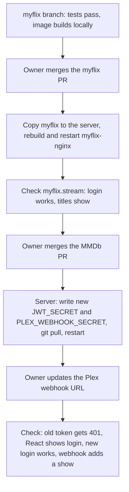

# Design

## Context

See proposal.md for why. The specs (`api-auth`, `plex-webhook`, `myflix-client-security`) give the required behavior.

MMDb today:
- `JwtAuth.token(u)` encodes `{sub, iat, iss, user}` with `JWT_SECRET` (HS256). `JwtAuth.decode` passes `iss:` but not `verify_iss: true`, which jwt 3.1.2 needs, so the issuer is never checked. `JwtAuth.has_expired?` and `renew_token?` are used only for TVDB's own token.
- v2 and v3 each define the same `/signup`, `/authenticate` and `authenticate!` (which turns any `JWT::DecodeError` into a 401 JSON message). `config.ru` uses `Rack::JSONBodyParser`, so the React login's `remember: true` arrives as a boolean in `params`.
- `webhooks_controller.rb` reads the payload from the `payload` form field or the raw body and checks `payload['Account']['title'] == ENV['PLEX_USER']`.

myflix (`frontend/client`, react-scripts 3.4.3, axios 0.19, redux, redux-form):
- `src/apis/mmdb.js` exports one axios instance; actions send `bearer <token>` read from `myflixUser` in `localStorage` or `sessionStorage`.
- `src/index.js` creates the store; `src/routers/AppRouter.js` exports `history`. Nothing dispatches `LOGOUT` or clears storage.
- `ShowPreview/index.js` is the only component that renders HTML (`dangerouslySetInnerHTML` for the title).
- The live copy (local folder and server, identical) is GitHub `master` `b918c03` minus its Dependabot pins, plus two edits: the production `baseURL` and the HTML title.

## Goals / Non-Goals

**Goals:**
- One sign-out of every API user, at the deploy that rotates the secret.
- Both repos' changes tested before deploy, the myflix ones with Jest in a Node 14 container.

**Non-Goals:**
- Token revocation or a deny list; `/deauthenticate` stays as it is.
- Escaping in MMDb's own ERB views (see Risks; a separate change).
- Unifying the duplicated v2 and v3 controllers.

## Decisions

**1. Lifetime is decided at issue and carried as `exp`.** `JwtAuth.token(user, lifetime:)` adds `exp: iat + lifetime`. The `/authenticate` routes pass 30 days when `params[:remember]` is `true` or `"true"` (JSON boolean from React, form string from anything else) and 1 day otherwise; `/signup` passes 1 day. The lifetimes are named constants in `JwtAuth`. *Alternative:* a server-side session table. Rejected: revocation is out of scope and the tokens stay stateless.

**2. Verification requires `exp` and checks the issuer.** `JwtAuth.decode` adds `verify_iss: true` and `required_claims: ['exp']`. jwt raises `MissingRequiredClaim`, `ExpiredSignature` or `InvalidIssuerError`, all `JWT::DecodeError`s, so both `authenticate!` methods already return 401 unchanged. Requiring `exp` rejects any token minted before this change even if the old secret were somehow kept. *Alternative:* rely on rotation alone. Rejected: requiring `exp` costs one option and makes the rule hold regardless of which secret is configured.

**3. Webhook secret in the query string, compared in constant time.** Plex cannot sign webhooks or send custom headers, so the URL carries `?token=`. A `before` filter in the webhook namespace halts with 401 unless `ENV['PLEX_WEBHOOK_SECRET']` is present and `Rack::Utils.secure_compare(ENV['PLEX_WEBHOOK_SECRET'], params[:token].to_s)` is true. It runs before the payload is parsed, so an unauthenticated request does no work. *Alternative:* allow-listing Plex's IP. Rejected: Plex posts from the media server, whose address can change, and the tunnel hides client IPs.

**4. The React interceptor is installed where the store exists.** A new module `src/apis/sessionExpiry.js` exports `installSessionExpiry(api, { dispatch, history, storages })`: an axios response interceptor that, on a 401, removes `myflixUser` from both storages, dispatches `{ type: 'LOGOUT' }`, calls `history.push('/login')`, and rejects with the original error so callers behave as before. `src/index.js` calls it once with `mmdb`, `store.dispatch`, `history` and `window`'s storages. Passing the collaborators in keeps the module free of imports from the store and router (which would form a cycle through `mmdb.js`) and lets Jest test it with a fake axios instance. A 401 from the login request itself runs the same path; the user is already on `/login`, so nothing visible changes. *Alternative:* the interceptor inside `mmdb.js`. Rejected: it would import the store, creating the cycle.

**5. Titles are decoded with `DOMParser`, rendered as text.** A helper `decodeEntities(text)` returns `new DOMParser().parseFromString(text, 'text/html').documentElement.textContent`. Documents from `DOMParser` are inert: scripts don't run and images don't load, so markup in a title is reduced to its text, and React escapes that text when rendering `{decodeEntities(show.title)}`. *Alternative:* a hand-written entity table. Rejected: titles can contain any named or numeric entity.

**6. The myflix branch starts from GitHub `master`.** Add `origin` (`https://github.com/toddseller/Myflix`) to the local repo, fetch, and branch from `origin/master`. The uncommitted local tree is set aside first (`git stash -u`), since its only content not on GitHub is the two live edits, which the branch re-applies: the production `baseURL`, and the title, now as text. The branch is pushed to GitHub and merged by the owner; myflix has no CI, so its Jest tests run locally in `node:14`.

**7. Deploy rehearses the image build first.** `docker compose build` of myflix runs locally before anything reaches the server, because the Dependabot pins in `yarn.lock` have never been built and the image uses Node 14. If the build fails because of the pins, revert `b918c03`'s two files on the branch, record that in tasks.md, and leave the pins for a later change.

**8. Secrets are created on the server and never printed.** One command appends both to `~/MMDb/.env` from `openssl rand -hex 64` (replacing the `JWT_SECRET` line), without echoing them. The Plex webhook URL is then read on the server by the owner (`grep PLEX_WEBHOOK_SECRET ~/MMDb/.env`), not through this session.

**9. Rollout order.**

## Risks / Trade-offs

- [The myflix image may not build on Node 14 with the 2023 pins] → rehearsed locally first (decision 7); the old image keeps serving until the new one is built.
- [A deploy gap: between the MMDb restart and the Plex URL update, webhooks are rejected] → anything Plex adds in that minute is not imported; add it again by hand or re-trigger from Plex.
- [Tokens stay valid until expiry after logout] → at most 30 days; revocation is out of scope.
- [The token sits in `localStorage`, readable by any script on myflix.stream] → the title fix removes the known injection point; moving the token is out of scope.
- [MMDb's ERB views don't escape output] → 18 `<%= ... title %>` outputs, plus plots and names, render raw on mmdb.online, a stored XSS separate from React. Its fix (turning on ERB escaping and checking every view) is the next change, `escape-html-in-views`.
- [The iOS app (v3) signs out at deploy and then daily or monthly] → it is dormant; no client change is planned.

## Migration Plan

See decision 9. Rollback: for MMDb, revert the merge commit but keep the new `JWT_SECRET`. Restoring the old secret from the backup (`~/MMDb/.env.bak-2026-10-23`, made before editing) would make every pre-change token, including any minted with the exposed secret, valid again, so do that only if the new secret itself is the problem. For myflix, rebuild from the previous commit.
