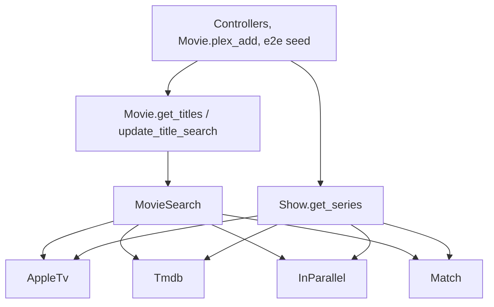

# Design

## Context

See proposal.md for the motivation. The relevant state of the code:

- `Show` holds everything outside-facing: `tmdb_request` (Net::HTTP with the `TMDB_TOKEN` bearer header, returns `{code:, body:}`), the Apple storefront list and query parameters, `appletv_search`, `in_parallel`, and the `same_name?`/`same_year?` rules. `TvdbMigration` is the only other caller of `Show.in_parallel`, `Show.tmdb_request` and `Show.appletv_show`, and it is being deleted.
- `Movie` calls TMDB through HTTParty with `?api_key=TMDB_KEY` and an unescaped `query=` (a title with `&` or `#` breaks the request). `get_titles` and `update_title_search` are near copies; `appletv_call` nests five levels deep and keeps only exact title matches.
- Tests stub outside calls by URL and query with WebMock (`spec/support/show_search_stubs.rb`), not by method, so moving request code between modules does not touch the show tests. `show_search_spec.rb` already has a timing test built on per-source delays.
- The e2e seed replaces `Movie.get_titles` and `Movie.update_title_search` by name, and `Movie.plex_add` calls `get_titles` and keeps only the exact title and year match.
- Database movies come back as ActiveRecord objects and are merged with plain hashes; the views and `plex_add` read both with `[:key]`.

## Goals / Non-Goals

**Goals:**
- One place each for talking to Apple TV, talking to TMDB, running requests in parallel, and deciding whether two titles are the same.
- Movie search built from those, in the same shape as show search, so the two read alike.
- `Show` loses its request plumbing and its TVDB and Heroku code with no change in show search behavior.

**Non-Goals:**
- No shared "source adapter" interface or generic merger for movies and shows; their merge rules differ (seasons, stored-show ids, directors).
- No move of `Show.get_series` or Show's response parsing (`appletv_show`, `tmdb_show`, episode lookups); they stay in `Show` and call the new clients.
- No change to `get_plot` or the other field helpers beyond deleting unused ones.

## Decisions

### Module layout

All new code lives in `app/models/`, which `config/database.rb` already loads with `autoload`, so nothing new is needed to load it.

- **`AppleTv`**: the storefront list (US, UK, CA, AU), the shared query parameters, `search(store, term)` returning the raw shelf items, and `view(path, store)` for `view/product/<id>` and `view/show/<id>[/episodes]`. It knows nothing about movies or seasons.
- **`Tmdb`**: `get(path, params = {})` built on today's `tmdb_request`, with the bearer token and with every parameter escaped. Returns `{code:, body:}` as now, so Show's callers change only the method name.
- **`InParallel`**: today's `Show.in_parallel`, moved without changes. A failing item still becomes `nil` and is logged.
- **`Match`**: `same_name?` and `same_year?` moved from `Show`, plus `same_director?` (last word of each director's text, with whitespace matched by `/[[:space:]]/` so U+00A0 counts; blank on either side matches).
- **`MovieSearch`**: Apple and TMDB movie lookups, the conversion of their responses into movie hashes, and the merge. `Movie.get_titles` reads the database on the calling thread and hands the rows to `MovieSearch`; `update_title_search` hands it none.

Alternative considered: one `Search` module per source holding both movie and show parsing (`AppleTv.movies`, `AppleTv.seasons`). Rejected for now because it moves all of Show's parsing too, which the user chose to leave in place.

### Apple ranking is shared with shows

Show search already ranks Apple hits (exact, starts with, contains, Apple's order within a rank) and keeps the first storefront per id. The same steps apply to movies with the item type `Movie` instead of `Show`, so `AppleTv` gets one helper that takes the hits from all four storefronts, the term and a cap, and returns the ranked, de-duplicated, capped `[id, store]` list. `Show.appletv_call` and `MovieSearch` both use it, and `apple_rank` moves with it.

The cap differs: shows keep 10 (`APPLE_SHOW_LIMIT`, unchanged), movies take 20. A movie costs one detail request and a show two, and on 2026-10-25 Apple returned 24 movies containing `rocky` and 27 containing `star`; 20 matches TMDB's page size and covers most of those for about one extra round of requests. Each constant lives with its caller rather than in `AppleTv`, so changing one never moves the other.

### Merge runs on the calling thread after every source answers

As in `get_series`: `InParallel` runs `:apple` and `:tmdb`, each fanning out internally, and the merge starts only after both return. The database rows never enter a thread (ActiveRecord would check out one connection per thread). Merging walks database, Apple, TMDB in order and keeps an entry only if no kept entry is the same movie under `Match`; the final sort is by year with the merge position as a tie-breaker, because Ruby's `sort_by` is not stable.

### Director comparison reads `director`, not `director_check`

The stored `director_check` column has the same non-breaking space problem as `director`, and its value depends on when the row was last saved. Comparing from `director` text each time needs no data change and treats every source the same. Search results still carry `director_check` so their shape stays the same, but nothing compares it any more. Dropping the column and its `before_save` is a schema change and stays out of scope.

### TMDB calls from movies use the bearer token

Using `Tmdb.get` for movies drops `TMDB_KEY` entirely, and checked on 2026-10-25: `search/movie` and `movie/<id>?append_to_response=credits,releases` answer with the token. `search_person` moves too, so no movie code reads `TMDB_KEY`.

### TVDB and Heroku are deleted, not stubbed

The `tvdb` branches in `get_episodes` and `plex_add` go. A season whose `collectionId` starts with `tvdb` then falls into the Apple branch, whose lookup fails on the bad id and returns no episodes; `appletv_episodes` already rescues and logs that. A guard that skips the request was considered and rejected: it would keep TVDB knowledge in the code for 4 shows that never change.

## Risks / Trade-offs

- [Partial Apple matching adds up to 20 product requests per movie search where exact matching made a few] → they run 8 at a time in parallel with TMDB, so 20 cost about 3 rounds of requests; the timing scenario in the spec covers it.
- [More requests at once to Apple and TMDB could hit rate limits] → each pool is capped at 8 threads as for shows, which has run in production since 2026-10-23 without errors.
- [Partial matching changes `plex_add` input] → `plex_add` already keeps only exact title and year matches, and the exact match ranks first so the cap never drops it; the spec's webhook scenario tests it.
- [A blank director matches anything, so a same-title, same-year film with no director merges into another] → accepted; real data shows the reverse (two 2008 "Rocky" films with directors) is the case that matters.
- [Refactor breaks show search] → `show_search_spec.rb`, `episode_lookup_spec.rb` and `show_edit_spec.rb` stub by URL and must pass unchanged; any edit to them in this change is a signal the behavior moved.
- [Removing the `TVDB_*`, `HEROKU_KEY` and `TMDB_KEY` compose entries] → the server `.env` can keep them; unset variables are simply not passed. Only `TMDB_TOKEN` must be present, and it already is.

## Migration Plan

1. Merge and deploy by release tag as usual; `docker compose up -d --build` recreates the container, so the compose file change takes effect.
2. After deploy, search `rocky` in Add Movie: one "Rocky" (1976), the stored one, plus "Rocky II" and the other partial matches; open the edit form's search on a movie; open a NOVA season 32 and see no episodes listed, with no error.
3. Rollback: deploy the previous tag. No data or schema changes, so nothing to undo.
