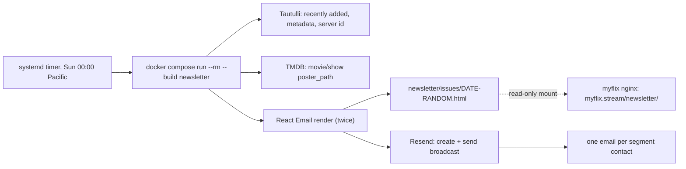

# Design

## Context

See proposal.md for why. The relevant pieces in place today:

- MMDb is a Sinatra app in one `web` compose service on onyx. Its `.env` already holds `TAUTULLI_KEY` and `TMDB_TOKEN`. It calls Tautulli at `https://plex.toddseller.dev/api/v2` (`Movie.plex_count`) and TMDB with a bearer token (`Tmdb.get`), both with a 5-second timeout.
- The repo already uses Node 24 for front-end unit tests (`node --test`) and for type-checking (`tsc`), but the production image is Ruby only.
- `bin/deploy` builds and recreates only `web`. A change to `bin/deploy` reaches production one deploy late, because the old script runs the deploy that installs the new one.
- Onyx runs Ubuntu 22.04 with its clock set to UTC. Cron is not installed. systemd 249 is, and lingering is enabled for the `onyx` user, so that user's systemd timers run without a login session.
- myflix.stream is a separate app on onyx: an nginx image (`~/myflix`, root `/usr/share/nginx/html`, `try_files $uri /index.html`) behind its own tunnel, which can only reach the `myflix_default` network.
- Checked against live data on 2026-11-13:
  - Tautulli's `get_recently_added` returns `movie`, `show`, `season` and `episode` items. It filters by count, not by date, and every item carries `added_at`.
  - `get_metadata` returns `tmdb://` guids for movies and shows on current Plex agents. A season's `tmdb://` guid is the season's own TMDB ID, not the show's.
  - `get_server_identity` gives the `machine_identifier` that Plex deep links need.
  - myflix.stream already carries Resend's DKIM and bounce records.

## Goals / Non-Goals

**Goals:**
- The job is a run-once process: started, finished and gone, with no scheduler or server of its own.
- Each run builds from the checked-out code, so deploys don't need to know about the job.
- Everything the job fetches is stubbed in tests, and tests need no real keys.

**Non-Goals:**
- Alerting when a run fails. Its output goes to the user journal on onyx, and a missing Sunday email is the signal.
- A sign-up page, or a listing of past issues. Subscribers are managed in Resend's dashboard.
- Per-reader content. Every reader gets the same issue.
- Moving MMDb's other Tautulli or TMDB calls into Node.

## Decisions

### A Node service inside MMDb, not Ruby and not a new app

`newsletter/` gets its own `package.json`, `Dockerfile` and tests, and the compose file gets a `newsletter` service that shares `.env`.

Alternatives considered:
- **ERB templates in Ruby.** This loses React Email, which was the point of the change.
- **React Email for a static template, filled in by Ruby.** JSX escapes ERB tags, and per-show card lists don't fit placeholder filling.
- **A separate app on onyx.** It would need a second `.env`, a second repo and a second deploy for one weekly job.

### TSX run by `tsx`, type-checked with `tsc`

React Email templates are JSX, and Node 24 strips TypeScript types but doesn't transform JSX. `tsx` runs `.ts`/`.tsx` directly, so there's no build step and no compiled output: the image runs `tsx src/main.ts`, and tests run with `node --import tsx --test`. `tsc --noEmit` in the package does the type-check. The alternative, compiling with `tsc` in the Dockerfile, adds a build stage and a `dist/` folder for no runtime gain.

### Fetch per library, page until the window ends

The job calls `get_recently_added` without `section_id`, asking for 100 items. Items arrive newest first, and the list ends at the first one added before 00:00 Pacific on the Sunday a week before the latest Sunday. Anchoring the window to Sunday midnight, rather than counting 7 × 24 hours back from the run, means a late rerun or a catch-up after downtime misses nothing since the last issue (it may repeat a title in the next one), and a daylight saving change neither skips nor repeats an hour. If all 100 are inside the window, the job asks again for 200, and so on. It then keeps only items from libraries 1 and 2. Both choices come from Tautulli's behaviour, checked on 2026-11-14:

- **With `section_id`, Tautulli lists every episode separately** and never returns a `season` or `show` item, so "Season 3" and "New series" couldn't be told apart from a pile of episodes.
- **Without it, `start` doesn't page reliably**: `start=50` jumped to items from February. A single request for a longer list is consistent; the first 100 items of a 400-item request match a 100-item request exactly.

Grouping key: a movie keys on its own `rating_key`, a show on its own, a season on `parent_rating_key` and an episode on `grandparent_rating_key`. A show card's label comes from what was grouped:
1. A `show` item makes it "New series".
2. Otherwise, any seasons are named ("Season 3", "Seasons 2 and 3").
3. Any episodes are counted ("1 new episode", "8 new episodes").
4. When a card has both seasons and episodes, both labels appear.

(Changed on 2026-11-14 by `newsletter-show-labels`: a show's label is one phrase that fits a phone's bar on one line, "New series", else "New season", else "N episodes", and a show card links to the season it is about, or to the show for a new series.)

A card's title and year come from the recently-added item itself (`parent_title` for a season, `grandparent_title` for an episode), so a failed lookup never costs a card its title. The job then makes one `get_metadata` call per card's movie or show `rating_key`, one card at a time, for its `tmdb://` guid. It never uses a season's guid, which is the season's own TMDB ID. TMDB `/movie/{id}` or `/tv/{id}` then gives `poster_path`, and the poster URL is `https://image.tmdb.org/t/p/w342{poster_path}`. If a card's metadata or TMDB lookup fails, it goes out without a poster. If the recently-added list or the server identity can't be fetched, the run fails: the issue would be incomplete or have broken links. Every request has the app's 5-second timeout.

The Plex link is `https://app.plex.tv/desktop/#!/server/{machine_identifier}/details?key=%2Flibrary%2Fmetadata%2F{rating_key}`.

### The hero

Each issue leads with a hero picked at random from the week's titles that have a wide TMDB backdrop (`backdrop_path`, at `w780`), movies and shows alike, shown with its title, chips (year, Movie or Series, label) and a Play button that opens it in Plex. The backdrop comes from the same TMDB response as the poster, so it costs no extra request. The hero leaves its grid so it isn't listed twice. Only a week with no backdrops at all goes without a hero. The pick happens once per run, before rendering, so the email and its browser copy show the same hero; a rerun may pick another. (Changed on 2026-11-14 from "the newest addition, or no hero if it lacks a backdrop", at the owner's request.)

The layout borrows from Netflix's emails, which myflix.stream's styling already follows: a light grey page, a white 600px column, the MYFLIX logo with a "Recently added" kicker, a "New this week." headline, the hero, then rounded poster grids with red badges for the show labels. (Changed on 2026-11-14: the masthead shows the ribbon M, the footer the wordmark, and every poster ends in a joined bar: the label in the accent colour for shows, "▶ Play" in the template's quieter colour for movies. A title without a poster shows a grey 2:3 placeholder image.)

### The footer

Every template shares one footer:
- **Both copies:** the "No Support Is The Best Support" line, and the Terms of Use and Privacy Statement line (plain text, since myflix.stream has no such pages). Every email has a dark footer band (`#262426`) with grey text.
- **Email copy only:** the membership line with its "click here" unsubscribe link, the do-not-reply line and "This message was mailed to [address]". The browser copy leaves these out.

The address is Resend's `{{{contact.email}}}` placeholder, passed in from one place by the run.

### Render twice from one component, send HTML

One `Issue` component takes the cards plus optional `viewUrl` and `unsubscribeUrl`. It is rendered twice:

- **Email:** with `viewUrl` set to the issue page and `unsubscribeUrl` set to Resend's `{{{RESEND_UNSUBSCRIBE_URL}}}` placeholder.
- **Web page:** with neither.

The job sends the email's HTML string, so it doesn't depend on whether Resend's broadcast API accepts a React element. The page has to be rendered to HTML anyway.

### Resend Broadcasts for one email per subscriber

The job creates a broadcast with `segmentId` (`RESEND_SEGMENT_ID`), the from address, a subject such as `Recently added to MYFLIX (Nov 15, 2026)` and the HTML, then sends it. Resend sends one email per subscribed contact, fills in the unsubscribe placeholder, adds the `List-Unsubscribe` headers and skips unsubscribed contacts.

Alternatives considered:
- **One email with everyone in BCC.** No per-reader unsubscribe.
- **Our own subscriber table plus a loop over `/emails`.** That means a new database table, an unsubscribe route, and header handling that Resend already provides.

**API key.** It has to be a Full access key. A test on 2026-11-14 with a Sending access key was refused when creating the broadcast ("This API key is restricted to only send emails"). The key lives only in the server's `.env`.

### The browser copy: a host folder served by myflix

The job writes `/issues/<YYYY-MM-DD>-<random>.html`, where the date is the run date and the random part is 6 bytes of `crypto.randomBytes` in base64url (8 characters). Compose mounts `./newsletter/issues` there, and the folder is gitignored. myflix's compose mounts `../MMDb/newsletter/issues` read-only at `/usr/share/nginx/html/newsletter`. nginx then serves the file, or falls back to the SPA for a name that doesn't exist. `autoindex` stays off, so the folder can't be listed.

The page is written before the broadcast is created, so a failed write stops the run before anything is sent. A send that fails after the write leaves an orphan page that nothing links to, which is harmless. The rerun writes a new page with a new random part.

Alternatives considered:
- **Serve from MMDb's `public/`.** The URL would be on mmdb.online.
- **A Cloudflare route on myflix-tunnel for `/newsletter/*` pointing at MMDb.** The tunnel would also have to join `mmdb_default`, and the routing would live in the dashboard, outside git.
- **S3.** It needs a new IAM permission for one more folder.

### Built by each run, not by `bin/deploy`

The compose service sits under `profiles: [newsletter]`, so `compose up` never starts it and `bin/deploy` doesn't touch it. A systemd user timer runs it. `newsletter/systemd/` holds two unit files:

- **`mmdb-newsletter.service`:** `Type=oneshot`, `WorkingDirectory=%h/MMDb`, `ExecStart=/usr/bin/docker compose run --rm --build -T newsletter`.
- **`mmdb-newsletter.timer`:** `OnCalendar=Sun *-*-* 00:00:00 America/Los_Angeles` and `Persistent=true`, so a run missed while onyx was down happens at the next boot.

They are installed once with `systemctl --user link` and `enable --now`. Output goes to `journalctl --user -u mmdb-newsletter`. Because the links point into the checkout, a pull updates the files, but systemd only rereads them after `systemctl --user daemon-reload`.

Alternatives considered:
- **Cron.** It isn't installed on onyx, and Ubuntu's cron has no per-entry timezone. A fixed UTC hour would drift by an hour between standard and daylight time.

`--build` rebuilds from the checked-out code each Sunday; with the layer cache that takes seconds. This avoids changing `bin/deploy` and the deploy-it-twice problem that comes with it. CI builds the image so that a broken Dockerfile or lockfile is caught before merge, not at midnight.

**Timezone in the job.** The compose service sets `TZ=America/Los_Angeles`, and Node's bundled time zone data honours it. The run date (holiday windows, issue name, subject) is therefore the Pacific date, even though the server runs on UTC.

### Templates: holiday windows first, then rotation by week

Templates share the card, link and footer components and differ only in their layout and styling. Each one takes the same props, so it can be rendered twice like the `Issue` component above. One data file lists the regular templates and the holiday windows, each window as a start and end month-day pair (inclusive) with one or more templates. v1 ships one regular template and one Christmas window, Dec 1 to Dec 26, with one template.

Selection takes the run date and nothing else:
1. If the date falls inside a holiday window, the candidate set is that holiday's templates. Otherwise it is the regular templates.
2. The template is `set[weekIndex mod set.length]`, where `weekIndex` is the number of whole weeks since Sunday 1970-01-04.

This needs no stored state, and consecutive Sundays always get consecutive indexes.

Alternatives considered:
- **Calendar week number.** It resets from 52 or 53 to 1 at New Year, which can repeat a template.
- **Storing the last template sent.** That needs a file or table that survives between runs, to cover a gap this design accepts (below).

Trade-offs:
- Adding or removing a template changes `set.length`. That shifts the rotation once and can repeat a template on the week of the switch.
- A holiday with one template repeats on every Sunday in its window; giving it a second template alternates them.
- Windows don't wrap around New Year. A window that needs to would be written as two windows.

### Preview

`react-email` is a dev dependency, and `npm run preview` starts its `email dev` server on the templates. The `Issue` component exports `PreviewProps` with sample movie and show cards, so the layout can be checked and screenshotted without calling Tautulli.

## Risks / Trade-offs

- **[Installing the timer is a manual step on onyx]** → The unit files are in git, and `DOCKER_DEPLOYMENT.md` gives the install commands. Edits need a `daemon-reload` to take effect.
- **[The two apps share a host path]** → Both projects' deploy docs name the path. The folder is created on onyx before either container starts, so Docker doesn't create it owned by root, which the job's user couldn't write to.
- **[The full-access Resend key could manage domains and contacts]** → The key exists only in the server's `.env`. A Sending access key can't create broadcasts (tested 2026-11-14), so there is no narrower option.
- **[Readers get Tautulli's issue and ours in the same week]** → The first real run goes to a test segment (`docker compose run -e RESEND_SEGMENT_ID=<test> ...`). Tautulli's newsletter is switched off before the first Sunday the timer is live.
- **[A Sunday run fails silently]** → This is accepted for v1 (see Non-Goals). The log shows why, and the run can be repeated by hand.
- **[Resend's placeholders or broadcast fields differ from what's assumed here]** → Checked on 2026-11-14 by sending this branch's issue to a two-contact test segment: both copies arrived with each reader's own address in the footer and working Plex links. After one contact unsubscribed through the footer link, a second send reached only the other.
- **[No TMDB credit]** TMDB's API terms ask apps to credit TMDB, and the owner chose to leave the credit out of the footer. → If TMDB asks, restore one line in the shared footer.

## Migration Plan

1. Merge and release this change. The web app is unaffected. Then create `~/MMDb/newsletter/issues` on onyx, and add `RESEND_API_KEY` and `RESEND_SEGMENT_ID` to the server's `.env`.
2. Merge and deploy the myflix PR that adds the read-only mount.
3. In Resend, create the live segment with the 8 current Tautulli recipients, plus a test segment holding only the owner.
4. Run the job by hand against the test segment. Check the email, the unsubscribe link, the "View in browser" page on myflix.stream, and the Plex links.
5. Turn off Tautulli's newsletter, then install and enable the timer.

**Rollback:** `systemctl --user disable --now mmdb-newsletter.timer` and turn Tautulli's newsletter back on. Nothing else depends on the job.
